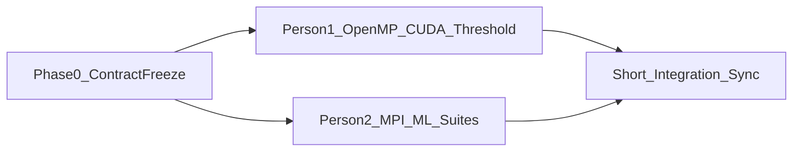
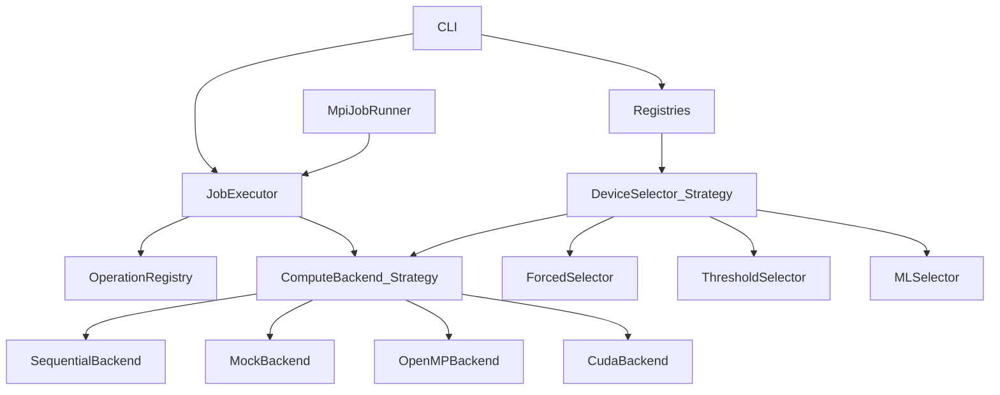

# Implementation Plan: Automatic CPU/GPU Selection (O08)

## Goal

Build a **Python** CLI that runs **map**, **sum-reduce**, and **filter** on sequential CPU, OpenMP-style parallel CPU, and CUDA, then in **auto** mode selects the device from problem size after short calibration. MPI distributes independent measurement jobs. A simple ML model (2-person extension) improves choice beyond static thresholds.

Design priority: **scalability and reuse** (Strategy / Factory / Registry) **and parallel team work** after one short contract freeze — neither person waits on the other’s full backend stack.

## Parallelism principle



- **Only blocking step:** Phase 0 contract (half day, pair).
- **After that:** both tracks compile/run against the contract using `SequentialBackend` and `MockBackend`.
- **Person 2 never waits** for real OpenMP/CUDA to finish MPI or the ML pipeline — they develop against the CSV schema + mock timings, then retrain on real logs in the sync window.
- **Person 1 never waits** for MPI/ML — selectors and backends register independently.

## Team Split

| Person 1 | Person 2 (you) |
|----------|----------------|
| `OpenMPBackend` | `MpiJobRunner` + suite partition metrics |
| `CudaBackend` (TRANSFER / RESIDENT) | `suites/*.json`, calib/test split configs |
| `ThresholdSelector` | `MLSelector`, `ml/train.py`, `ml/metrics.py` |
| Thread-profitability experiments | Synthetic log generator + regret/accuracy report scripts |

**Shared (Phase 0 only):** ABCs, registries, `Job`/`Result`, CLI, CSV schema, `JobExecutor`, `SequentialBackend`, `MockBackend`, `ForcedSelector`.

## Concrete Stack (locked)

- **Language:** Python 3.11+
- **Arrays:** NumPy
- **OpenMP-style CPU:** Numba `prange` / `parallel=True`
- **CUDA:** Numba `@cuda.jit`
- **MPI:** `mpi4py` (same `JobExecutor`)
- **ML:** scikit-learn + joblib
- **Packaging:** `pyproject.toml`
- **Config:** JSON suites under `suites/`

## Architecture (patterns for reuse)



### Core patterns (locked)

1. **Strategy — `ComputeBackend`:** `map` / `reduce` / `filter` / `timed_call` / `supports_resident`
2. **Strategy — `Operation`:** `prepare_input` / `run` / `reference` / `verify`
3. **Factory / Registry:** backends, ops, selectors created by name; new impl = class + one register line
4. **Strategy — `DeviceSelector`:** `choose(op, n, context) -> backend_name`
5. **Template Method — `JobExecutor`:** resolve → select → run → verify → log (CLI and MPI share this)
6. **Batch — `JobSuite`:** JSON list of jobs; MPI partitions the suite

### Unblocking stubs (Phase 0 deliverable)

- **`MockBackend` (`"mock_cpu"` / `"mock_gpu"`):** correct results via NumPy (same as sequential) but **synthetic timings** `t = alpha + beta * n` (different coeffs per mock device). Lets Person 2 train `MLSelector` and test `--mode auto-ml` immediately.
- **Optional registry stubs** for `"omp"` / `"cuda"` that raise a clear `BackendNotReady` until Person 1 replaces them — CLI/MPI must tolerate missing optional backends (skip or fail that job only).

### Scalability rules

- Horizontal: MPI job slices; Vertical: threads / CUDA grid via kwargs
- Extensibility: never edit executor/MPI when adding backend/op/selector
- Experiments scale via `suites/` config, not code
- One CSV schema for all producers/consumers

## Target Layout

```
PRiR-Projekt/
  pyproject.toml
  README.md
  PROJECT_DESCRIPTION.txt
  IMPLEMENTATION_PLAN.md
  src/prir/
    types.py
    ops/           # shared Phase 0
    backends/
      base.py
      sequential.py      # Phase 0
      mock.py            # Phase 0 — synthetic timings
      openmp_backend.py  # Person 1
      cuda_backend.py    # Person 1
      registry.py
    selectors/
      forced.py          # Phase 0
      threshold.py       # Person 1
      ml_selector.py     # Person 2
      registry.py
    runtime/             # Phase 0 — executor, timing, csv
    mpi/runner.py        # Person 2
    cli.py               # Phase 0
  ml/                    # Person 2
  suites/                # Person 2 owns configs; Person 1 may add omp/cuda sweeps
  scripts/
  results/
  docs/report.md
  tests/
```

## Shared Contract (freeze in Phase 0 — then diverge)

Lock these artifacts in-repo before splitting:

| Contract item | Why it unblocks both |
|---------------|----------------------|
| `ComputeBackend` / `Operation` / `DeviceSelector` ABCs | Implement without merge conflicts on core |
| Registry `create(name)` API | Drop-in `"omp"`, `"cuda"`, `"ml"` later |
| CLI flags + exit codes | Same commands for local and CI smoke |
| CSV columns (exact names/order) | ML and thresholds consume any producer |
| `Job` / `Result` / `TimingMode` | MPI and CLI share executor |
| Dtype + reduce tolerance (`float64` or `float32`, `rtol=1e-5`) | Independent correctness tests |
| `MockBackend` timing formula + seed | Reproducible ML pipeline without GPU |

**CLI (locked sketch):**
```text
python -m prir.cli --op map|reduce|filter --n N --mode cpu|omp|cuda|auto|auto-ml|mock_gpu
                  [--threads K] [--timing transfer|resident] [--log results/run.csv]
mpirun -n P python -m prir.mpi.runner --suite suites/….json --log results/mpi.csv
```

**CSV row (locked):**  
`timestamp,op,n,backend,threads,timing_mode,time_ms,correct,selector,chosen,predicted,calib_phase,rank,world_size`

**Operations (locked):** map `x*x+0.5*x`; reduce sum; filter `x > threshold`.

## Schedule: contract then two parallel tracks

### Phase 0 — Contract freeze (pair, ~0.5 day)

Do **together**, then stop pairing:

- Package + ABCs + registries + `JobExecutor` + CSV logger + CLI
- `SequentialBackend`, three ops, `ForcedSelector`
- `MockBackend` with synthetic timings
- Smoke tests: CLI cpu path; registry; CSV round-trip
- Written contract checklist in README (flags, schema, tolerances)

**Exit:** both people can work on separate branches/files with zero dependency on the other’s unfinished backends.

---

### Track A — Person 1 (starts immediately after Phase 0)

**A1. OpenMPBackend**
- Numba parallel map/reduce/filter; thread sweep vs sequential; register `"omp"`
- Local correctness tests only need sequential reference (already present)

**A2. CudaBackend**
- Numba CUDA kernels; `TRANSFER` and `RESIDENT`; register `"cuda"`
- Independent of MPI/ML

**A3. ThresholdSelector**
- Fit thresholds from **any** CSV matching the schema (including Person 1’s own calib runs)
- `--mode auto` → `"threshold"`
- Does not depend on ML code

**Person 1 mid-checkpoint (async):** push sample `results/calib_omp_cuda.csv` when A1+A2 work — Person 2 can optionally retrain early, but is **not blocked** if this is late.

---

### Track B — Person 2 (starts immediately after Phase 0)

**B1. MpiJobRunner**
- Partition `JobSuite` across ranks; each rank calls **existing** `JobExecutor`
- Develop and measure against `cpu` + `mock_*` backends first
- Metrics: per-job latency vs suite throughput (jobs/s, makespan)
- When `"omp"`/`"cuda"` appear in registry later, same suites work unchanged

**B2. Suites + calib/test split tooling**
- Own `suites/calibrate.json`, `test.json`, `mpi_smoke.json`
- Script to emit **synthetic CSV** (same schema, mock crossover behavior) for ML CI

**B3. MLSelector end-to-end without real GPU**
- `ml/train.py` / `metrics.py` on synthetic then real CSV
- Features: op, `n`, `log2(n)`; label: faster backend (or regress times → argmin)
- Register `"ml"`; `--mode auto-ml`; fallback to threshold **by name** if model missing (tolerate threshold module arriving later via registry)
- Report metrics: accuracy, regret, regret + amortized tuning cost

---

### Phase Sync — short integration (both, ~0.5–1 day)

Only place where tracks merge:

1. Register real omp/cuda; run shared calibration suite → real CSV
2. Person 1 finalizes threshold fit on real CSV; Person 2 retrains ML on same CSV
3. Joint: local auto vs auto-ml test sizes; `mpirun` suite with real backends
4. Fill `docs/report.md`; freeze demo commands in README

**Exit:** full O08 demo; no long idle time before this for either person.

## Deliverables Checklist

**Person 1:** OpenMP + CUDA backends, threshold auto, thread-profitability + transfer-vs-resident numbers

**Person 2:** MPI runner + throughput analysis, suite configs, ML selector + metrics, synthetic-data ML pipeline proving the contract

## Risk Notes

- CUDA filter compact: two-pass count+scatter inside `CudaBackend` only
- Optional backends missing: executor skips or errors per-job without crashing the suite
- Avoid merge conflicts: Person 1 touches `backends/openmp*`, `backends/cuda*`, `selectors/threshold*`; Person 2 touches `mpi/`, `ml/`, `selectors/ml_*`, `suites/`; shared files frozen after Phase 0 unless paired

## Milestones

1. Contract frozen (Phase 0)
2. Track A: omp green / Track B: MPI on mock green (same week, independent)
3. Track A: cuda + threshold / Track B: ML on synthetic green
4. Sync: real calib CSV, both selectors, report
